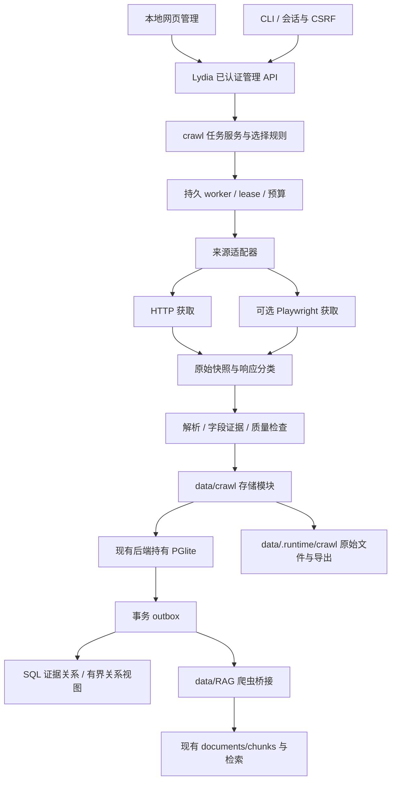

# Hackathon 采集架构设计

状态：用户已于 2026-11-04 确认设计并授权实现。本文保留完整目标设计；当前可运行范围与缺口见 [实施状态](IMPLEMENTATION_STATUS.md)。日期：2026-11-04，Asia/Kuala_Lumpur。

## 1. 目标与边界

为 Lydia 建立可恢复、可追溯的 2025–2026 Hackathon 项目资料库。保留原 prompt 的十个来源、L1 基础索引、全部已核验获奖项目及受限 finalist 的 L2/L3、网页与 CLI、CSV/JSON/Markdown、证据关系浏览和现有 RAG 接入。2026 年仅含运行时已公开内容。

附件称为“已确认”的条目是本设计采用的需求基线，不代表已完成或已取得外部平台权限。每赛事 finalist-only 20、总计 200 是建议默认值；Neo4j、云厂商、付费模型均未确定。获奖项目数量不受这些上限截断，预算只暂停执行。

## 2. 已检查的系统事实

| 真实代码 | 观察及设计影响 |
| --- | --- |
| `business/backend/server.ts` | Node HTTP 服务，默认 127.0.0.1:4318；已有登录、Origin、CSRF、请求大小限制和静态资源白名单；新增路由须走这些检查 |
| `business/shared/config.ts` | 数据库路径默认 `business/.runtime/data`；不是根目录 `data` 内的数据库 |
| `data/database/store.ts`、README | PGlite + pgvector；单服务进程持有数据库；不能从爬虫 CLI 再调用 `Store.open` 打开同一目录 |
| `data/database/schema.sql` | 既有 cases/documents/chunks/tasks 等表；现有 tasks 属于专家工作流，不能直接混入爬虫任务 |
| `data/RAG/retrieval.ts` | MARKET/PROJECT 必须有 caseId；METHOD 为全局；按 case 检索，没有全局项目库入口 |
| 同上 | 文档内容去重发生在 case/collection 内；doc/chunk 使用 UUID；相同 canonical URL 的内容变化会替换当前版本 |
| 同上 | 分块为字符窗口，保留 start/end/heading；正文最多 150000 字符；并非已经具备语义章节分块 |
| `data/RAG/sources.ts` | 已有 HTTP(S)、DNS/IP/重定向 SSRF 防护；但返回清理文本，未保留响应字节、完整头、快照或分页信息，不可直接充当证据采集器 |
| 同上 | `ingestURL` 固定写 MARKET，不可用于 Hackathon 档案自动入库 |
| `business/package.json` | Node >=24，已有 playwright-core 开发依赖；开发依赖存在不代表浏览器运行环境已安装 |

本次环境实际读取到 Node v24.12.0、Python 3.13.5。工作区根不是 Git 仓库，未创建提交。未读取生产数据库、未修改现有业务代码。

## 3. 三个方案与选择

| 方案 | 优点 | 成本与限制 | 决定 |
| --- | --- | --- | --- |
| A：TypeScript 模块 + 现有后端 + HTTP/Playwright | 同一认证和数据库所有者，直接复用 RAG；Windows 进程管理简单 | 要实现站点解析器和持久任务；浏览器资源需单独配置 | 推荐 |
| B：Python/Crawl4AI 独立 worker + Lydia 接入 API | 便于复用 Python 提取工具，适合未来重型获取 | 多运行时、IPC、版本和部署成本；仍不能直接打开业务 PGlite | 保留为可选获取后端 |
| C：browser-use/AI agent 主导每次采集 | 适合探索未知交互 | 结果和成本不稳定，难证明分页完整及可重放 | 仅辅助勘察 |

A 的职责是调度与确定性提取；可选 B 只能返回标准 FetchResult，不拥有第二套项目主库。首版不引入 SQLite、Redis、Neo4j 服务或第二套向量库。

## 4. 组件与数据流

以上是拟建架构，不表示已有运行链路。

### 拟新增文件边界

| 位置 | 职责 |
| --- | --- |
| `crawl/core/service.ts` | run、任务、暂停/恢复及阶段升级；由 backend 注入数据接口 |
| `crawl/core/worker.ts` | 执行、lease token、到期恢复、停止及预算 |
| `crawl/core/selection.ts` | 获奖纳入、finalist 配额与确定性重选 |
| `crawl/fetch/http.ts`、`browser.ts` | 共同 FetchResult；字节/头/最终 URL/状态/时间，浏览器附 DOM 与采集方式 |
| `crawl/sources/<source>.ts` | 站点导航、分页终止、实体与字段证据提取；逐站按验证增加 |
| `crawl/quality/rules.ts` | 页面类型、年份、阶段必需字段、证据和引用检查 |
| `crawl/cli.ts` | 经 API 发起操作；不打开数据库 |
| `crawl/web/` | 拟新增管理视图源码，构建产物挂载 `/crawl/`；共用后端 session |
| `data/crawl/store.ts` | 爬虫主记录、队列、outbox 和参数化 SQL |
| `data/crawl/snapshots.ts` | 原始字节、DOM/正文保存、哈希、原子写入、孤儿清理 |
| `data/database/migrations/` | 拟新增带版本迁移；不把现有 schema 初始化误称为迁移框架 |
| `data/RAG/crawl-bridge.ts` | 证据文档投影、case 导入、引用映射及失效同步 |
| `business/backend/crawl.ts` | 管理与 case 接入路由；由 server.ts 注入共享 Store |
| `business/tests/crawl*.test.ts` | 临时库离线测试；联网 smoke test 单独运行 |

路径为责任边界建议；按阶段创建实际有行为的文件，不先堆空模块。

## 5. 抓取流程

1. 勘察赛事入口、结果入口与访问规则，保存核查时间。官方结果列表与作品发现并行推进，避免只从详情页找奖项而漏掉获奖者。
2. L1 保存来源项目、参赛记录、年份依据、原始字段、缺失原因和分页检查点。发现分母未知时覆盖率为 unknown。
3. 用可追溯的官方结果确认获奖/阶段；无法匹配项目的结果记录进入待复核池，不能丢弃。
4. 所有获奖项目进入 L2 和 L3 待执行清单；finalist-only 在配额内选择。阶段执行预算和选择清单分开保存。
5. HTTP 优先，确认是 JS 空壳后才切浏览器；验证码、授权失败、禁止采集规则不触发“绕过”后端。
6. 先保存快照，再解析与校验，事务写规范记录、证据、任务结果和 outbox。失败留下原始资料以便重解析。
7. 明确项目身份才合并；同名、相似文本、fork 不足以认定同项目。奖项挂 Submission，技术观察挂 ProjectVersion。
8. L3 只扩展直接引用资源；记录 commit、版本时间及“赛事时实现未知”，不执行项目代码。
9. outbox 驱动关系/RAG 投影；索引失败不撤销成功采集。导出包含版本、范围、数量和未完成项。

## 6. 恢复、限流与预算

状态：pending → running → succeeded；临时失败到 retry_wait；权限/挑战到 blocked；超出预算或用户暂停到 paused；确定无法处理到 failed；取消到 cancelled。抓取状态、质量状态、研究层级和奖项状态各自独立。

任务幂等键包含来源、任务类型、实体、阶段、参数哈希及刷新代次。同代次重试复用任务；增量刷新创建新代次。每次领取产生 lease_token 和 expires_at，提交必须匹配当前 token；超时任务可重新领取，旧 worker 无权覆盖结果。

暂停 run 后禁止领取；正在执行的任务在超时内完成并提交，超时终止后恢复为可重试状态。停止应用时先停止领取、取消有界网络请求、完成安全收尾，再关闭 PGlite。浏览器子进程不持有主库。

按域名与全局分别限制请求，并保留浏览器独立配额。建议 pilot：全局 HTTP 并发 2、每域 1、请求间隔 2 秒、浏览器并发 1、请求超时 30 秒、最多 3 次尝试、每批 50 页/20 分钟/200 MiB 快照。均是待试抓校准的建议值。Retry-After 有效时遵守服务端时间；429 降速，挑战或规则禁止转 blocked，重试次数耗尽转 failed。

浏览器的导航、子请求、重定向、WebSocket 和下载都须防止访问本地/保留地址；仅校验初始 URL 不足。若无法做到网络隔离与 DNS 防护，browser 后端保持禁用，不能宣称继承了 HTTP 的 SSRF 保护。

快照用内容寻址，先临时文件落盘再原子重命名，DB 事务只能引用已存在文件。提交失败形成孤儿文件，可按保留期回收；不能形成 DB 成功但文件尚未落盘的记录。DB 与文件系统不宣称跨介质原子事务。

## 7. finalist 规则

先形成范围内全部 verified winner 规范项目集合，不占 finalist-only 名额。其余官方明确 finalist 项目按年份、来源、赛事、赛道形成分层队列，按配置 seed 和稳定实体 ID 排序，轮询分配总名额；同层不足的名额转给尚有候选的层。

多赛事候选按 `(赛事年份, source_id, event_id)` 固定顺序指定主选赛事，主选赛事配额已满则尝试其下一个可用赛事；不能在其他赛事重复计名额。最终同时校验总项目上限与每赛事主选归属上限。记录候选、selected/not_selected、原因、主选赛事、seed 和规则版本。对身份不确定者分开统计，确认合并后重新对账。

新公布奖项优先升级；旧选择历史和已抓证据保留。人工固定选择仍受 finalist-only 上限约束，超限必须显式修改配额；获奖者始终独立纳入。报告唯一项目数、参赛记录数与主选归属数。

## 8. 数据与 RAG

详见 [数据契约](../../data/crawl/DATA_CONTRACT.md)。根 `data` 是处理模块目录，不意味着把现有 PGlite 目录搬家。新增快照/正文/导出建议存 `data/.runtime/crawl/`，通过配置解析为绝对路径，不能依赖进程 cwd。

采用“全局采集主库 + case 内检索投影”。全局库以 SQL 搜索和结构化筛选浏览；用户选定研究 case 后，将选中项目资料投影到该 case 的 PROJECT 集合。不同项目的奖项/实现资料不得默认成为 MARKET 的用户需求证据；不借 METHOD 绕过全局库缺口。全局向量检索属于后续独立改造，首版不冒充已有能力。

现有 ingest 按正文 hash 去重，可能合并不同项目的相同正文，也可能跳过 metadata-only 更新；本桥接需要增加可选的 origin_key 和完整投影指纹，默认行为保持兼容。将 project_version、resource、content_version 纳入来源身份，禁止同 URL 跨项目互相失效。稳定外部 document/chunk key 由爬虫侧维护，与现有 UUID 双向映射。

大于 150000 字符的资源按章节分为多个 RAG 文档，每部分保存原文绝对偏移与 part index；不静默截断。来源更改、撤回、合并与撤销触发 outbox，先将受影响旧投影标记 stale 并排除检索，再重建并激活新版，保留历史用于审计。无 embedding 时关键词检索可用。

## 9. 网页、CLI 和关系浏览

拟新增 `/crawl/` 管理页，复用同源 session 和 CSRF。需要调整 server.ts 的静态资源白名单与 MIME 支持；管理页源码放 crawl/web，由构建脚本输出对应静态资源，不改现有聊天首页流程。

页面包含 run 状态、来源能力、项目筛选、获奖待办、finalist 配额与原因、快照证据、质量复核、同步积压和导出。关系图默认一跳，最多两跳、100 节点/200 边；响应包含 truncated、截断原因和同步版本。点击边显示证据性质和快照。Neo4j 默认关闭，SQL 主数据即可提供关系浏览。

CLI 使用同一 `/api/crawl` 路由。交互登录通过终端隐藏输入读取密码，取得会话 Cookie 与 CSRF；请求附合法 Origin；令牌仅驻留内存，日志脱敏。无人值守会话/专用受限机器令牌若有需求另行设计，不能绕过现有认证。

## 10. 分阶段交付与验收

| 阶段 | 独立交付 | 验收证据 |
| --- | --- | --- |
| P1 | 版本迁移、队列、快照、HTTP、CLI、一个来源真实 L1/详情闭环 | 临时库中断恢复、重复执行不增重、真实样本与快照引用；先核查访问规则 |
| P2 | 第二种页面结构来源、浏览器后端、来源模板与分页检测 | 两站独立报告；空壳/200 挑战页隔离；重复游标显示 incomplete |
| P3 | 获奖/finalist、L2/L3、质量复核、三种导出 | 获奖不被预算截断；稳定配额；CSV 外键和公式防护；未知结果不补值 |
| P4 | 本地网页、SQL 关系视图、case RAG 桥接与 outbox | 网页与 CLI 共用任务；跨 case 隔离；metadata-only 更新；旧引用失效；图扩展边界 |
| P5 | 余下八站逐站适配或明确受阻记录、增量任务 | 十站状态矩阵，逐项列样本量、失败原因、覆盖窗口和分页完成证据 |
| P6 | 云迁移契约、容器本地验证与运维 | 没配置返回未配置；迁移前停止本地执行权，数据/哈希核验；不创建付费资源 |

离线测试使用人工核对的小样本和独立临时数据库；联网 smoke test 单独运行。检索对照使用同一资料快照、问题和上下文预算，分别比较现有检索与图扩展，报告证据命中、引用支持、事实错误和耗时，无人工答案不报准确率。

首版不同时启动十站批量采集；完整目标仍包含所有阶段，只有完成对应验收才标记该能力可用。

## 11. 当前验证边界与资料

已完成仓库文件检查和本机版本读取。只通过网页工具观察 ETHGlobal Showcase 入口可返回项目列表，**未进行目标站原始 HTTP 获取、robots/规则核查、分页验证、样本入库或完整 source audit**。十个来源均未达到爬虫实测通过状态。

设计参考：

- [Playwright 官方网络文档](https://playwright.dev/docs/network)：用于动态页面公开请求观察和网络控制方案，不能证明目标站可批量抓取。
- [Crawl4AI 官方文档](https://docs.crawl4ai.com/)：存在本地库与云服务两条路径；本设计不启用云服务。
- [ETHGlobal Showcase](https://ethglobal.com/showcase)：2026-11-04 仅核查入口可读，不据此推断分页或奖项完整性。

PGlite 单进程限制依据项目 `data/database/README.md` 与当前 Store 所有权设计；本次官方 multi-process 页面未成功读取，不将该请求写为外部验证成功。
